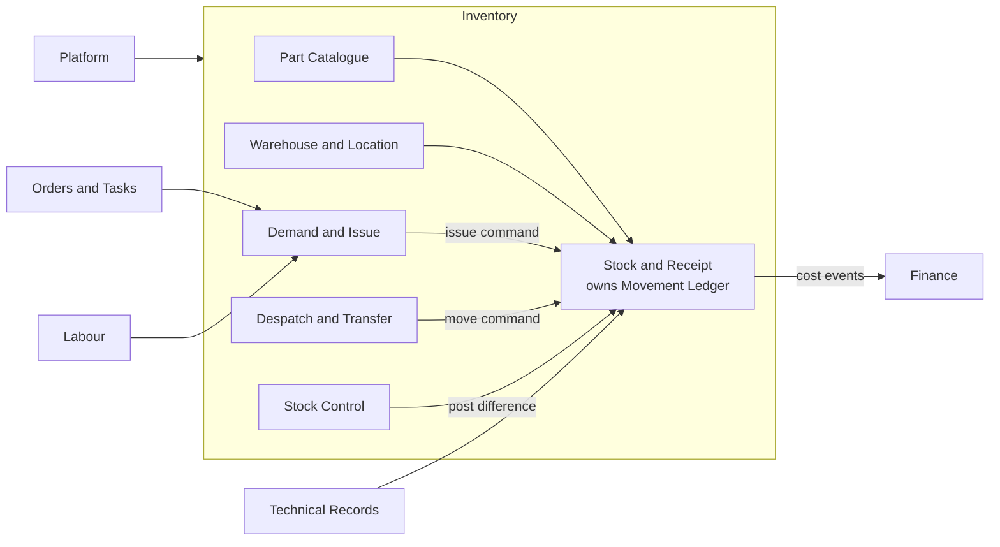

# Task 1 – Bounded Contexts for the Inventory Module

## 1. Assumptions (page-1 material)

| Prefix | Assumed module | Example columns |
|---|---|---|
| `a` | Finance and accounts | `aJournalID*`, `aTransactionID*`, `aAccountID`, `aCurrencyID`, `aPeriodID`, `Amount*` |
| `t` | Technical records | `tATAID`, `tApprovalID`, `tAssetID`, `tToolID`, `tLifeCodeID` |
| `l` | Labour | `lEmployeeID*` |
| `uRAL` | Platform (users, bases, rights) | `uRALUserID`, `uRALBaseID` |
| `sOrder…` (outside the 44) | Orders and tasks | `sOrderTaskID`, `sOrderPartID`, `sOrderPartScheduleID` |

- Contracts with neighbouring modules (APIs and events below) are **assumed**. They are designed from Inventory's point of view and need confirming with the owning teams.
- Inventory is deployed as a modular monolith (decision recorded in Task 5). Contexts are code and data boundaries, not separate services.

## 2. Contexts

| # | Context | Purpose | Owns (legacy tables) | Main aggregate |
|---|---|---|---|---|
| 1 | Part Catalogue | Defines what a part is and the rules that follow from it | `sPart`, `sPartClassification`, `sPartAlternative`, `sPartCondition`, `sPartStatus`, `sPartATA`, `sPartModel`, `sPartClass`, `sPartUnitName`, `sPartUnit` | Part |
| 2 | Stock and Receipt | Physical stock, receipts, certificates, life data and the movement ledger | `sStock`, `sOrderPartReceipt`, `sOrderPartReceiptStatus`, `sOrderPartReceiptDiscrepancy`, `sOrderPartReceiptLifeCode`, `sOrderPartReceiptCert`, `sOrderReceiptNo`, `sStockOwnership`, `sStockStatus`, `sStockCategory`, `sStockLog`, `sPartWriteOff` | StockItem, MovementLedger |
| 3 | Warehouse and Location | Where stock lives and the rules for each place | `sBaseWarehouseLocation`, `sBaseWarehouse`, `sBasePlant`, `sBaseLocation`, `sBaseWarehouseLocationHistory`, `sStockLocationCategory` | Location |
| 4 | Demand and Issue | Requests for parts, picking, issue and core returns | `sDemand`, `sDemandPart`, `sDemandItemStatus`, `sPartIssue`, `sCoreReturn`, `sPickingList`, `sPickingListItem`, `sOweBack` | Demand |
| 5 | Despatch and Transfer | Shipping and transfer documents | `sDespatch`, `sDespatchPart`, `sPartDespatch`, `sStockBaseTransfer`, `sIBT` | Despatch |
| 6 | Stock Control | Counting stock and min/max policy | `sStockCheck`, `sStockCheckPart`, `sMinMax` | StockCheck, MinMaxPolicy |

Notes:
- `sStockLog` and `sBaseWarehouseLocationHistory` are log and history copies. They are replaced by the movement ledger in context 2.
- `sPartWriteOff` is a stock adjustment, so it sits in Stock and Receipt, not Despatch.
- `sPartDespatch` is a movement line. It is migrated into the ledger.
- Despatch owns the shipping document. Stock owns the quantity change.

## 3. Context responsibilities

| Context | Core workflows | Key rules it protects |
|---|---|---|
| Part Catalogue | Create and approve parts, manage alternates and classification | Valid status; alternates are approved and traceable; shelf-life and certificate rules are consistent with classification |
| Stock and Receipt | Receive stock, write off, record certificates and life data, write ledger entries | Serialised item has quantity 1; quantity never negative; every movement has a source and destination; every movement traces to a receipt, certificate and serial or batch |
| Warehouse and Location | Maintain warehouses and locations and their behaviour flags | Flags cannot conflict (for example DoNotAllocate with Allocation); unserviceable stock may not sit in a serviceable location |
| Demand and Issue | Request, reserve, pick, issue, return cores | Controlled state transitions; stock must match condition, location and ownership rules |
| Despatch and Transfer | Create despatch and inter-base transfer documents | A despatch references real stock; quantity changes go through Stock |
| Stock Control | Count by location, post differences, set min/max | Posted differences reconcile with stock and the ledger; closed checks are immutable |

## 4. Context map

Reading the map:
- Part Catalogue and Warehouse and Location are upstream of Stock and Receipt.
- Demand, Despatch and Stock Control send commands to Stock and Receipt. Stock validates the rules and writes the ledger entry.
- All neighbouring modules connect through an adapter at the boundary.

## 5. Neighbouring modules (assumed contracts)

| Neighbour | Inventory consumes | Inventory publishes | Replaces legacy columns |
|---|---|---|---|
| Orders and Tasks | `GET /orders/{id}` and `GET /tasks/{id}`: reference and status of the order line or work order | `PartIssued`, `StockReceived` | `sOrderTaskID`, `sOrderPartID`, `sOrderPartScheduleID` kept as external IDs |
| Technical Records | Approval and certificate lookups, ATA and asset references | `StockReceived` with certificate and life data | `tApprovalID`, `tApprovalCertLineID`, `tATAID`, `tAssetID` kept as external IDs |
| Labour | `GET /employees/{id}`: name for display | None | `lEmployeeID*` kept as external IDs |
| Finance | Currency and period reference data | `StockReceived`, `StockIssued`, `StockWrittenOff`, `StockTransferred` with quantity and cost | `aJournalID*`, `aTransactionID*`, `Amount*Cost` leave the Inventory schema |
| Platform | Identity token, base membership, rights | None | `uRALUserID*` and `uRALBaseID*` kept as external IDs |

## 6. Rules that keep dependencies from leaking

1. Other modules' data is stored as an external ID. Their tables are never copied.
2. One anti-corruption adapter per neighbour. Inventory code never uses a neighbour's model directly.
3. Finance is told through events. Finance owns journals and postings. Inventory owns quantity and cost.
4. A snapshot of neighbour data is kept only when a screen must display or search by it (for example an employee name on an issue record). It carries a refresh rule.
5. Contexts talk to each other through application services and commands, never through each other's tables.
6. Only Stock and Receipt writes to the movement ledger.

