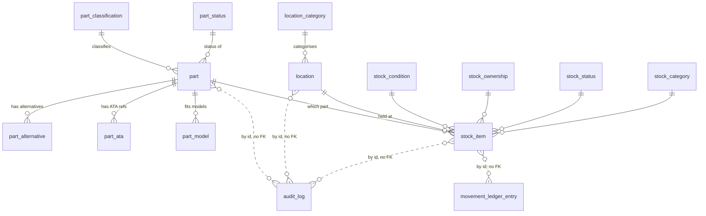
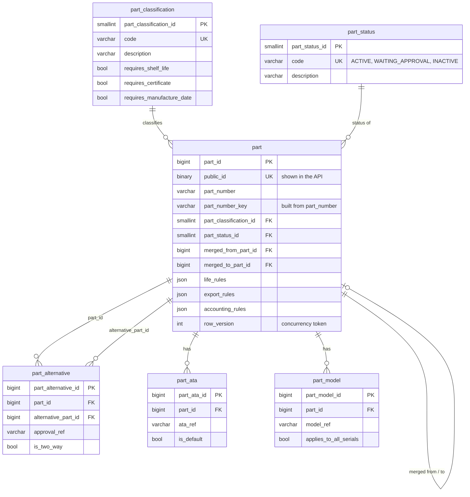
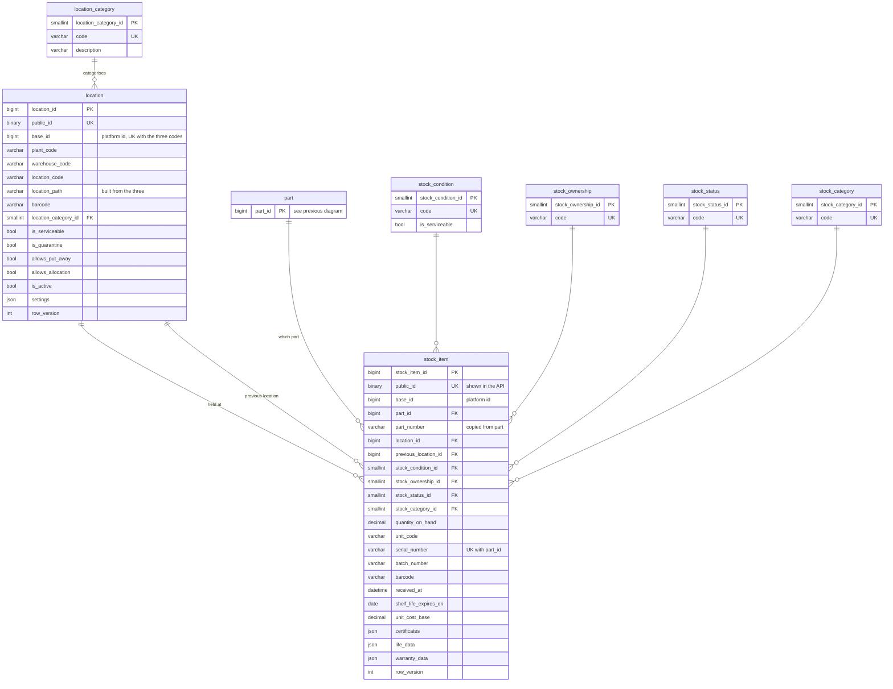
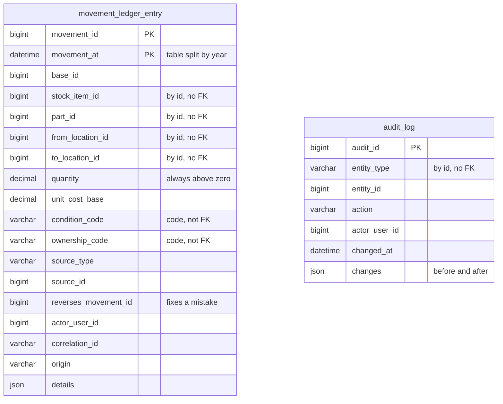

# Inventory ERD: Aggregates, Child Entities and Lookups

Four diagrams, same structure as the slides. Paste any block into a Mermaid viewer (GitHub, VS Code preview, mermaid.live).

Key: PK primary key, FK foreign key, UK unique key. Lookups are the small code tables.

## 1. Overview

## 2. Part aggregate

Part is global: it has no base_id.

## 3. Location and stock item aggregates

Copied part fields are refreshed by events and can be up to 60 seconds old. base_id is an id from the platform; there is no base table in Inventory.

## 4. Ledger and audit log

Why no foreign keys: history must survive changes to stock items, inserts stay fast on a very large table, old years can be archived, triggers block updates and deletes, and a wrong entry is fixed by adding a reversing entry.
