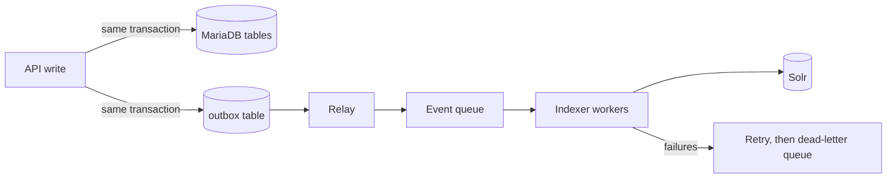

# Solr Search Model, Sync Design and Staleness Policy

MariaDB is the system of record. Solr is a read model built from it and can be thrown away and rebuilt at any time. Solr serves search only. Exact, current data (one item with its certificates, movements, audit) comes from MariaDB.

## 1. Collections and sizing

| Collection | Documents | Approx. size per document | Index size | Shards x replicas |
|---|---|---|---|---|
| `stock_item` | 6 million | 2 KB (estimate) | about 12 GB | 2 shards x 3 replicas |
| `part` | 1.2 million | 2 KB with alternates (estimate) | about 2.5 GB | 1 shard x 3 replicas |
| `location` | a few thousand | small | under 100 MB | 1 shard x 3 replicas |

There is no movement collection. Movements are listed per stock item from MariaDB, which the assignment also specifies, and 40 million rows a year are not searched free-text.

Why these numbers:
- **Size is not the issue.** 12 GB fits easily in memory-mapped files on a node with 32 GB RAM. Two shards give each query some parallelism and room to grow to about 20 to 30 million documents before splitting.
- **Three replicas** give availability. One replica can be down for maintenance while another fails and the collection still answers, which is what the 99.9% target needs.
- **Load.** 2,500 concurrent users is, say, 250 to 500 searches a second at peak (assumption: a user searches every 5 to 10 seconds). Each of the three replicas takes about a third. A search over this index normally takes tens of milliseconds, so the 300 ms p95 target has headroom. The load test in Task 5 should prove it.
- These are starting points to be confirmed by a load test, not final.

## 2. Stock item document

One flat document per stock item. Field names are the database column names, in snake_case, with an explicit schema (no guessing by suffix).

| Field | Solr type | Use |
|---|---|---|
| `stock_item_id` (unique key) | string | Same as the database primary key. |
| `base_id` | plong, docValues | Always in the filter query. |
| `part_id` | plong | Link to the part and for alternates lookup. |
| `part_number` | string | Display and exact match. |
| `part_number_key` | string | Normalised key, exact match. |
| `part_number_search` | analysed text (see section 3) | Typing with dashes, spaces, case, prefixes. |
| `part_description` | text_general | Free-text search. Copied from Part. |
| `serial_number` | string and `serial_number_search` | Exact, and normalised prefix. |
| `batch_number`, `barcode` | string | Exact. |
| `location_id`, `location_path` | plong, string | Filter and display. |
| `condition_code`, `ownership_code`, `status_code`, `category_code` | string, docValues | Facets and filters. |
| `is_serviceable` | boolean | Facet. |
| `quantity_on_hand` | pdouble | Sort and range. |
| `shelf_life_expires_on` | pdate | Range facet, sorting. |
| `has_certificate` | boolean | Filter. |
| `life_tsn_hours` | pdouble | Range filter. |
| `received_at`, `updated_at` | pdate | Sort. |
| `doc_version` | plong | The row version, used to reject stale updates (section 5). |
| `part_row_version` | plong | Version of the part values copied in (section 6). |

Not in Solr: the full certificate list, full life data, warranty, cost and remarks. These are shown on the detail screen from MariaDB. Keeping documents small keeps the index fast.

Facets: condition, ownership, status, category, location, base, classification, shelf-life range (next 30, 90, 365 days), serviceable.

Sorting uses `docValues` fields, and paging uses cursors (`cursorMark`) with `stock_item_id` as the tie-break, so it works beyond the first few thousand results.

## 3. Finding AB-1234/5 however it is typed

The user may type `AB-1234/5`, `ab 1234 5`, `ab12345` or `AB1234/5`. All must match the same part.

1. **Same normalisation in the database and at query time.** `part_number_key` is the part number with everything except letters and digits removed, upper-cased: `AB12345`. The search service applies the same rule to what the user typed before it builds the query. This rule exists once in code, with a shared test list, so the database and search cannot drift.
2. **Exact match field.** `part_number_key` is a string field. An exact match on the normalised value scores highest.
3. **Prefix and partial match.** `part_number_search` is analysed. At index time: strip non-alphanumeric characters, lower-case, then edge n-grams from 2 to 20 characters. At query time: strip and lower-case only, no n-grams. So `ab12` and `ab123` find `AB12345`.
4. **Also searchable as words.** The original `part_number` is split on punctuation into tokens (`AB`, `1234`, `5`) in a second field, so a user who types only `1234` still finds it, with a lower score.
5. **Ranking.** Exact key match first, then prefix, then token match, then description text. Boosts are set in the search service, not by clients.

Where the user is typing a serial number, the same approach applies to `serial_number_search`.

## 4. Alternate part numbers

Alternates are searched at query time, not copied into stock documents.

1. The `part` collection holds a multi-valued `alternate_part_keys` field, built from `part_alternative` (both directions when `is_two_way` is true).
2. When the user searches stock by part number, the search service first asks the `part` collection for the matching part and its alternates. This is a small, fast query.
3. It then queries `stock_item` with `part_id` in that list, as a filter, and marks results that came from an alternate part so the screen can say "alternate for AB-1234/5".

Reason for this choice: if alternates were copied into every stock document, one change to an alternate list would rewrite millions of documents. As a query-time lookup it changes in one place. Chains of alternates are followed to a limit of two levels, an assumption to confirm with the business.

## 5. Sync design: from commit to searchable in 5 seconds

1. **Outbox in the same transaction.** When the API changes an aggregate, it writes a row to an `outbox` table in the same database transaction: entity type, entity id, row version, change type. If the transaction rolls back, no event exists. If it commits, the event is guaranteed to exist. This removes the "database saved but event lost" problem.
2. **Relay.** A small process reads new outbox rows (polling every 500 ms is the simple start, or change-data-capture on the binary log later) and puts them on a queue, then marks them sent. If the relay crashes, it re-reads unsent rows.
3. **Indexer workers.** They take events in batches, read the current row from MariaDB (not the event payload, so they always index the latest state), build the Solr document, and send a batch update. Reading the current state makes lost or reordered events harmless.
4. **Visibility.** Solr is set to make updates visible within 1 second (soft commit). Hard commits run less often for durability.

Time budget (typical, estimated):

| Step | Time |
|---|---|
| Commit and relay poll | up to 0.5 s |
| Queue and worker pick-up | up to 0.5 s |
| Read row and build document | under 0.1 s |
| Send to Solr and make it visible | up to 1.5 s |
| **Total** | **about 2.5 s typical, under 5 s target** |

The 5-second target is measured as an indexing lag metric (commit time to searchable time), with an alert at 3 seconds and a page at 5.

**Failures and retries.** A failed batch is retried with growing waits (for example 1, 2, 4, 8 seconds). After the limit, events go to a dead-letter queue and raise an alert. A replay tool re-sends them. A bad single document never blocks the batch, as the worker retries items one by one when a batch fails.

**Duplicates.** The Solr unique key is the database id, so indexing the same event twice just overwrites the same document with the same content.

**Out-of-order events.** Each document carries `doc_version`, the row version. Solr is configured to reject an update whose version is lower than the stored one. A late, old event is therefore ignored. Because workers also read the current row, an old event normally builds the newest document anyway.

**Deletes and deactivation.** A delete is an event too, applied as a delete in Solr. For safety, a nightly job compares ids and versions between MariaDB and Solr and repairs differences (section 7).

## 6. Staleness policy: a part description changes

A stock document copies `part_number`, `part_number_key` and `part_description` so search needs no join. When Part changes, up to millions of copies are out of date. The policy:

| Question | Position |
|---|---|
| Same transaction or later? | Later. The Part update commits alone, with an event. Updating a hot part's stock rows inside one transaction could lock tens of thousands of rows and block storekeepers. |
| How fast? | The part's own document: within 5 seconds. Copies on its stock documents: target within 60 seconds for typical parts, and within 5 minutes for the largest. |
| How is it done? | The event goes to a fan-out worker. It finds the part's stock ids (indexed by `part_id`), and updates them in chunks of a few thousand, with low priority so ordinary stock changes are not delayed. In MariaDB the copied columns on `stock_item` are updated in the same chunked way. In Solr it is a partial update of only those fields. |
| What does the user see in the meantime? | The old description in search results for a short time. The detail screen reads MariaDB and the part itself, so it shows the current value. Nothing that decides stock, quantity or compliance depends on the copied text. |
| How do we know it finished? | Each stock document stores `part_row_version`. A job counts documents whose value is below the part's version. The count should reach zero. If it does not, the job re-queues them. |
| Scale | The average part has about 5 stock records (6 million over 1.2 million parts). Description changes are rare. The worst case is a common consumable with tens of thousands of rows, which chunking handles in seconds to minutes. |
| Failure | The same retry and dead-letter route as normal indexing, plus the nightly reconciliation, which catches any remaining stale copy. |

Fields that must never be stale (quantity, location, condition, status) are not copied from another aggregate. They belong to the stock item and follow the normal 5-second path.

## 7. Rebuilding an index without downtime

Used for a schema change, an analyzer change, a bad deployment or a disaster.

1. Create a new collection, for example `stock_item_v2`, with the new schema. Live traffic uses the alias `stock_item_live` pointing at `stock_item_v1`.
2. Note the current outbox position. Start reading events from that point into a holding queue.
3. Bulk-load `v2` from MariaDB in key ranges, in parallel, using a consistent read so each range is internally consistent.
4. Apply the held events to `v2`. The version rule makes it safe if a row appears in both the bulk load and the events.
5. When `v2` has caught up, run the check: document counts per base, sampled documents compared with MariaDB, and the 500 saved search queries compared with `v1`.
6. Switch the alias to `v2` (one fast, atomic step). Keep `v1` and keep feeding it for an agreed period, so rollback is another alias switch.
7. Drop `v1` after the period.

Full rebuild with an alias switch is the main method. Atomic (partial) updates alone are used only for small changes such as the staleness fan-out. They cannot fix a changed analyzer, because the stored tokens are the old ones.

A nightly reconciliation compares ids and versions between MariaDB and Solr, per base, and repairs differences. A full rebuild is rehearsed at least once per quarter, with its duration recorded.

## 8. Position on the decisions the assignment names

| Decision | My position | Alternative rejected, and why |
|---|---|---|
| Primary key | BIGINT, with a time-ordered UUID as `public_id`. | UUID as primary key: larger indexes and foreign keys, and no benefit when MariaDB is the only writer. Replication is not an issue with a single writer. Partners use `public_id`, so internal numbers are never exposed. |
| Copied attributes | Asynchronous fan-out through events, with a version stamp and reconciliation. | Same transaction: simple and always consistent, but one change to a common part could lock thousands of stock rows during working hours. |
| Variable attributes | JSON for detail data, with generated columns for the few fields screens filter on. | Child tables for everything: a join and many rows for data mostly shown, not searched. JSON only, with no generated columns: slow filters. |
| Solr document shape | One flat document per stock item. Alternates handled at query time. | Parent and child documents: block joins are slower and updating a child rewrites the whole block. Flat documents also make facets simple. |
| Rebuilds | Full rebuild with alias switch, plus atomic updates for small changes. | Atomic updates only: cannot change analyzers or fix drift, and a bug stays in the index. |
| Base isolation | A `base_id` column and a filter query added by the search service from the user's token. | One collection per base: 8 collections to manage, cross-base search and transfers become harder, and uneven base sizes waste replicas. The risk of the filter approach is a missed filter, which is why the service adds it, not the client, and a test checks every query path. |

## 9. Assumptions and open questions

1. Document sizes and query rates are estimates and need a load test.
2. Users who work at more than one base can search several bases at once. Transfers need to see the destination base's stock.
3. Alternate chains are followed to two levels.
4. Is 60 seconds acceptable for copied part text on stock results? The business may prefer 5 seconds, which would cost more indexing capacity.
5. Cross-base visibility rules for search (for example whether stock at another base is shown read-only) need a business answer.
