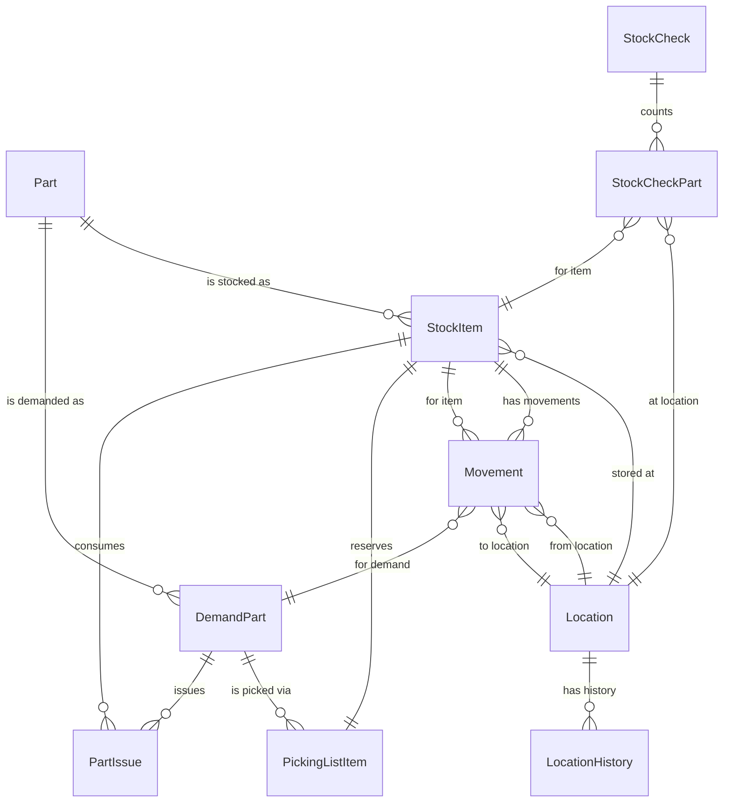

# EDR Inventory Aggregates – Readme

## Purpose
This document summarises the core aggregates for the EDR Inventory Modernization assignment and presents an ERD-style view of how they relate. Use it as a reference before we proceed to detailed data modelling and architecture.

## Aggregate overview

### Part aggregate
Represents the business concept of a part number and its metadata.

Key entity: `Part`

Important related entities (conceptual):
- `PartClassification` – classification and behaviour (asset/tool/material, shelf-life required, certificate required, etc.).
- `PartCondition` – serviceable/unserviceable conditions.
- `PartStatus` – lifecycle status (active, inactive, waiting approval).
- `PartATA` – ATA chapter associations.
- `PartModel` – aircraft/asset models the part applies to.
- `PartUnit` / `PartUnitName` – unit of measure and packing units.
- `PartAlternate` – alternate part relationships and approval/authority.

### Stock Item aggregate
Represents a physical stock item at a location, tied to a receipt.

Key entity: `StockItem`

Important related entities:
- `Receipt` – data from incoming orders/repairs (serial/batch, certificate, life data, costs).
- `StockOwnership` – company/customer ownership flags.
- `StockStatus` – stock-level status (e.g., warranty, core return).
- `StockCategory` – categorisation for reporting/controls.
- `Certificate` – links to release certificates.
- `LifeCode` – usage/life tracking.
- `Movement` – entries in the movement ledger for all stock movements.

### Location aggregate
Represents a physical storage location, its base/plant and behaviour.

Key entity: `Location`

Important related entities:
- `Warehouse` – logical grouping of locations at a base.
- `Plant` – site/plant under a base.
- `LocationCategory` – category and rules for locations.
- `LocationHistory` – history of moves between locations.

### Demand aggregate
Represents demand for parts and the issue process to work orders.

Key entity: `DemandPart`

Important related entities:
- `Demand` – header for one demand request.
- `DemandItemStatus` – status workflow of demand lines.
- `PickingList` / `PickingListItem` – picking instructions and reserved stock.
- `PartIssue` – actual issue of stock to work orders/tasks.
- `CoreReturn` – handling of returned cores.

### Stock Check aggregate
Represents stock checking and reconciliation.

Key entities:
- `StockCheck` – one stock-check event.
- `StockCheckPart` – per-location counted items and differences.

### Movement ledger (cross-cutting)
The movement ledger is a single append-only entity that records every stock movement (receipts, transfers, issues, write-offs, returns, etc.), linking:
- A `StockItem` (or logical stock record).
- Source and destination `Location`.
- Related `DemandPart` / `PartIssue` / `Despatch` when applicable.
- Relevant audit data (who, when, why), receipt and certificate references.

It acts as a cross-cutting aggregate providing traceability across the Inventory domain.

## ERD-style relationships

Below is a conceptual ERD using Mermaid notation. It shows aggregates and their main relationships, not full table-level details.

### Relationship notes

- **Part → StockItem**: Each `StockItem` references a single `Part`, but a `Part` may have many stock items across bases and locations.
- **Part → DemandPart**: Demand is expressed for a `Part`; later picking and issuing operate on specific `StockItem` instances.
- **StockItem ↔ Location**: A `StockItem` is stored at exactly one current `Location`; historical locations are visible via `Movement` and `LocationHistory`.
- **DemandPart → PickingListItem → StockItem**: Demand lines drive picking; picking list items reserve or allocate specific stock items.
- **DemandPart → PartIssue → StockItem**: Issuing links the demand to the stock item actually consumed by a work order.
- **StockCheck ↔ StockCheckPart ↔ StockItem/Location**: Stock check lines connect counted quantities at a location to the underlying stock items, creating adjustments that become movements.
- **Movement ledger**: Central to traceability, linking operational actions (receive, issue, transfer, write‑off, return) to stock items, locations, and demands.

## How to use this readme

- Treat this ERD as the conceptual backbone for:
  - Designing denormalised MariaDB tables per aggregate (Part, StockItem, Location, Demand, StockCheck).
  - Designing the movement ledger table and its indexing.
  - Shaping Solr documents for search-first access to stock and parts.
  - Reasoning about invariants (e.g., quantity never negative, unserviceable stock cannot be in a serviceable location, every movement traces to a receipt and certificate).

As you review this, note any invariants or relationships that feel unclear or risky; those will inform refinements in the next design steps.
