# EDR Redsign

# Assumptions

## Meaning of legacy data

1. **Shelf life is an expiry date**, not a duration.
2. **A serial number is unique per part**, not across all parts. So a serialised item has quantity 1.
3. **The two cost columns are two currencies**: order currency and base currency. `RC` means reporting currency.
4. **`BarCode` and `sStockBarCode` are the same thing** and merge into one `barcode`. Rows where they differ are flagged.
5. **`AB-1234` and `AB1234` are the same part**, so the cleaned part number key is unique. Legacy duplicates are listed by the migration.

## Business rules

6. **Base is owned by the platform.** Inventory stores only `base_id`. Part is global.
7. **Records are kept 7 years** after the item leaves stock.
8. **Users at several bases can search across them.** Whether they see another base's stock is a business decision still to be made.

## Targets that need a test

9. **Search copies of part text can be up to 60 seconds old.** Quantity, location, condition and status are never stale.
10. **Sizing is an estimate**: about 2 KB per stock document, 2 shards with 3 replicas, 250 to 500 searches a second at peak. A load test confirms it.
11. **Recovery times are designed, not proven.** The quarterly failover and restore drills prove the 5-minute RPO and 1-hour RTO.


# 1. Bounded Context

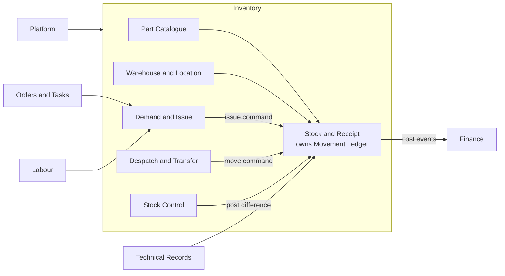

# Inventory ERD: Aggregates, Child Entities and Lookups

Key: PK primary key, FK foreign key, UK unique key. Lookups are the small code tables.

## 1. Overview

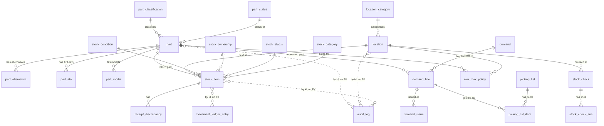

## 2. Part aggregate

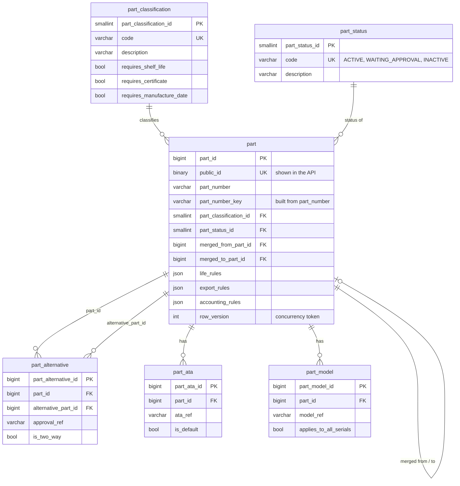

Part is global: it has no base_id.

## 3. Location and stock item aggregates

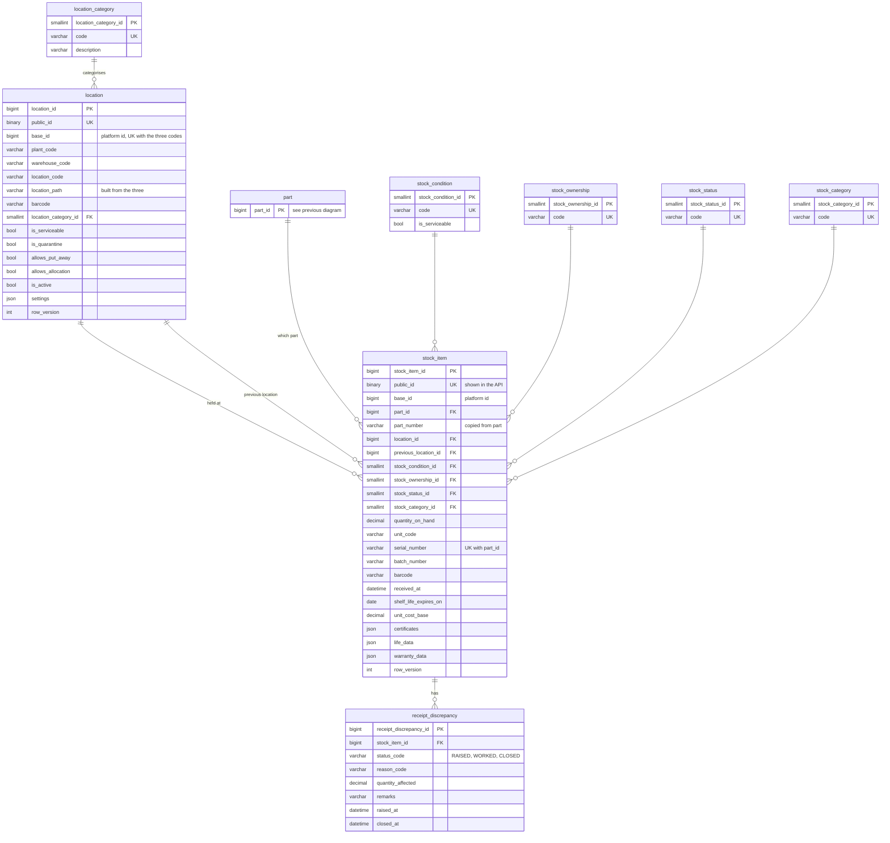

Copied part fields are refreshed by events and can be up to 60 seconds old. base_id is an id from the platform; there is no base table in Inventory.

## 4. Demand aggregate

A demand is a mechanic's request for parts for a job. These tables are proposed from the disposition table and are not in the DDL yet. Column lists are the main ones only.

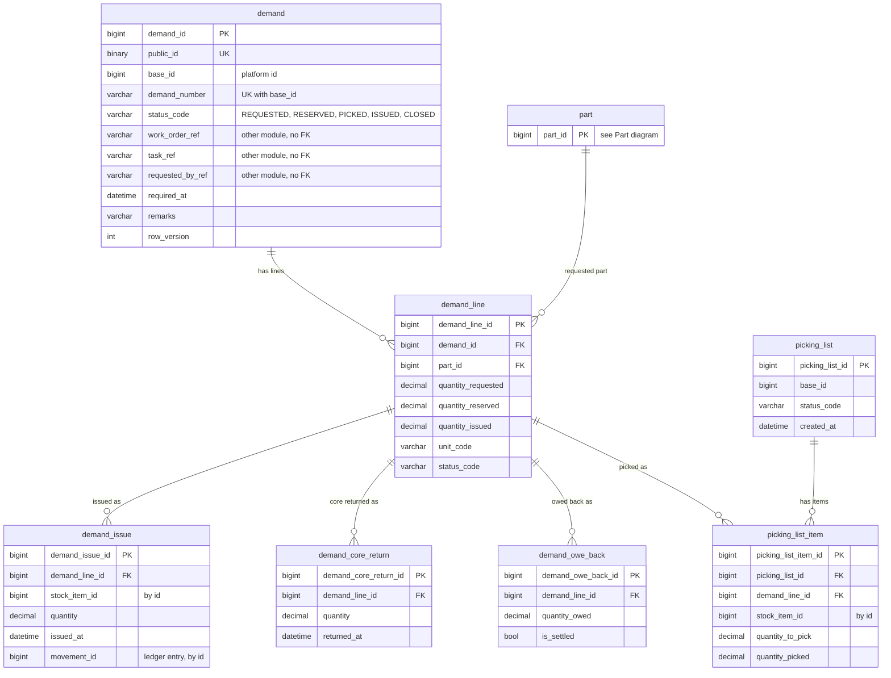

Rules the demand protects:
- Quantity issued never exceeds quantity requested.
- Status only moves forward (for example issued cannot go back to requested). The allowed moves are in code.
- An issue creates a ledger entry in the same transaction.
- Work order, task and requester are references to other modules. They have no foreign key.

## 5. Stock check aggregate

A stock check is a count of stock at a location. Posting it writes the differences to the ledger.

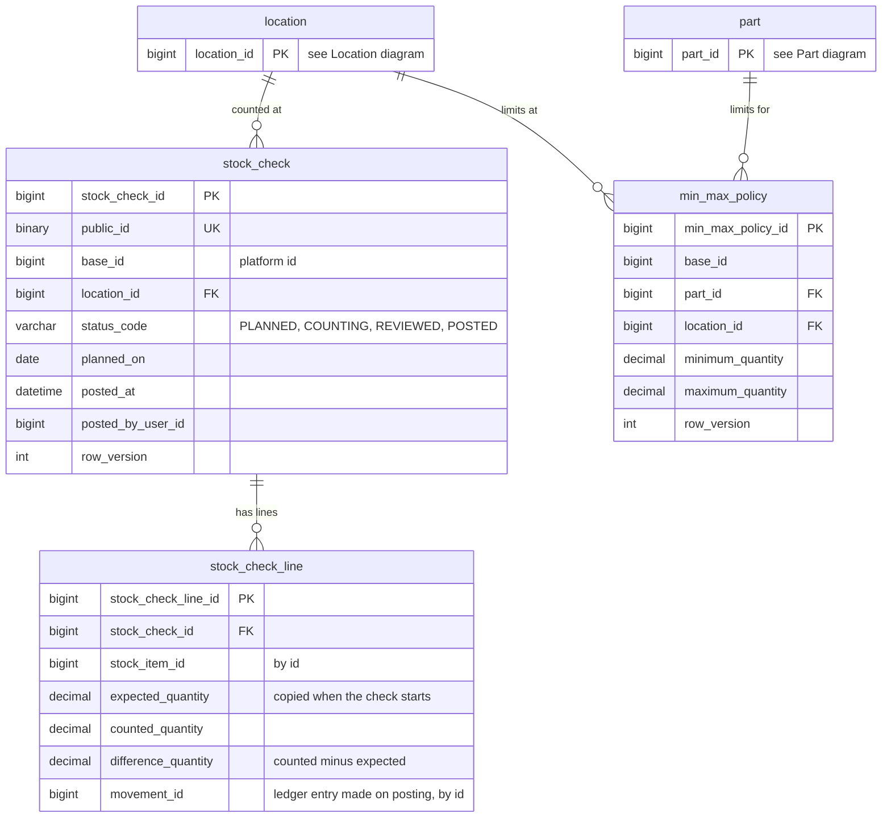

Rules the stock check protects:
- Lines can be edited only before the check is posted.
- Posting writes one ledger entry per line with a difference, all in one transaction.
- Expected quantity is fixed when the check starts, so later movements do not change what was counted.
- A posted check cannot be changed. A mistake is fixed by a new check.

min_max_policy is a small planning table kept apart, so changing a limit never locks stock rows.

## 6. Ledger and audit log

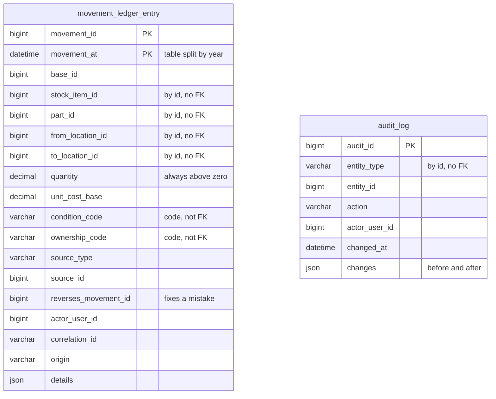

Why no foreign keys: history must survive changes to stock items, inserts stay fast on a very large table, old years can be archived, triggers block updates and deletes, and a wrong entry is fixed by adding a reversing entry.


# Legacy Table Disposition

This section records what happens to each important legacy table in the new Inventory design. 

## Core business tables

| # | Legacy table | Context | Decision | New home | Rationale | 
|---|---|---|---|---|---|
| 1 | `sPart` | Part Catalogue | Keep | `part` (root) | The catalogue entry for every part. It has its own lifecycle (draft, approved, inactive) and every other aggregate refers to it. | 
| 2 | `sPartClassification` | Part Catalogue | Merge | Flags on `part`, code list kept as lookup | Flags such as shelf-life required and certificate required drive write rules and search, so they sit on the part row. The code list stays for reference. |
| 3 | `sPartAlternative` | Part Catalogue | Keep | `part_alternative` (child of Part) | One-to-many, and search needs it so a request for one part number can find its approved alternates. `tApprovalID` is externalised to Technical Records. |
| 4 | `sPartATA`, `sPartModel` | Part Catalogue | Keep | `part_ata`, `part_model` (children) | Used to filter parts by aircraft chapter and model, so they stay searchable child tables. |
| 5 | `sPartUnit` | Part Catalogue | Merge | Columns on `part` | Unit of issue is one value per part, so a separate table only adds a join. |
| 6 | `sStock` | Stock and Receipt | Merge | `stock_item` (root) | The physical item on a shelf. Combined with its receipt line so one row answers "what is this, where is it, and where did it come from". |
| 7 | `sOrderPartReceipt` | Stock and Receipt | Merge | `stock_item`, with life and warranty data in JSON | Serial, batch, condition and ownership become columns because screens filter by them. Detail-only fields go to JSON. Cost and journal columns are externalised (see row 25). Text copies such as `PartNo` and `Location` are dropped because they duplicate real references. |
| 8 | `sOrderPartReceiptCert` | Stock and Receipt | Merge | `certificates` JSON on `stock_item` | A receipt can carry several certificates. They are shown on the detail screen but rarely searched, so a JSON array with type, number, date and approval reference fits. | 
| 9 | `sOrderPartReceiptLifeCode` | Stock and Receipt | Merge | `life_data` JSON on `stock_item` | Life data varies by part type. Fields that need searching, such as hours since new, are exposed as generated columns. |
| 10 | `sOrderPartReceiptDiscrepancy` | Stock and Receipt | Keep | `receipt_discrepancy` (child) | Discrepancies are raised, worked and closed, so they have their own small lifecycle. |
| 11 | `sPartWriteOff` | Stock and Receipt | Merge | `movement_ledger_entry` (type `WRITE_OFF` or `WRITE_ON`) | A write-off is a stock adjustment, not a document. The misspelt `WriitenOffDate` maps to the ledger timestamp. | 
| 12 | `sBaseWarehouseLocation` | Warehouse and Location | Keep | `location` (root) | The bin or shelf, with rules such as serviceable stock only. It is the target of every move. |
| 13 | `sBaseWarehouse`, `sBasePlant`, `sBaseLocation` | Warehouse and Location | Merge | Copied IDs and names on `location` | Short, stable hierarchy. Copying base, plant and warehouse onto each location removes three joins from every stock search. |
| 14 | `sDemand` | Demand and Issue | Keep | `demand` (root) | A mechanic's request for a job. Has its own status and owns its lines. |
| 15 | `sDemandPart` | Demand and Issue | Keep | `demand_line` (child) | Keeps request and reservation data. Issue and return detail moves to the children below, and finance columns are externalised. |
| 16 | `sPartIssue`, `sCoreReturn`, `sOweBack` | Demand and Issue | Keep | Children of `demand` | Each records a business event against a demand line. The quantity change itself goes to the ledger. |
| 17 | `sPickingList`, `sPickingListItem` | Demand and Issue | Keep | `picking_list`, `picking_list_item` | Stores staff work from picking lists, so they need to exist as documents with their own status. |
| 18 | `sDespatch`, `sDespatchPart` | Despatch and Transfer | Keep | `despatch`, `despatch_line` | Shipping documents with addresses, air waybill, flight and export licence. Stock rules don't belong here, and this data doesn't belong in stock. |
| 19 | `sPartDespatch`, `sStockBaseTransfer`, `sIBT` | Despatch and Transfer | Merge | `movement_ledger_entry` (types `DESPATCH`, `TRANSFER_OUT`, `TRANSFER_IN`) | These record quantity leaving one place and arriving at another, which is exactly what the ledger holds. Transfer cost columns are externalised. |
| 20 | `sStockCheck`, `sStockCheckPart` | Stock Control | Keep | `stock_check` (root) and `stock_check_line` | A count has its own lifecycle: planned, counting, reviewed, posted. Posting writes adjustments to the ledger. |
| 21 | `sMinMax` | Stock Control | Keep | `min_max_policy` | A small planning rule per part and location. Kept apart so changing a threshold never locks stock rows. |

## Lookup and workflow status tables

| # | Legacy table | Decision | New home | Rationale |
|---|---|---|---|---|
| 22 | `sPartStatus`, `sPartCondition`, `sPartClass`, `sPartUnitName` | Keep as lookups | `ref_*` tables, with codes copied onto rows | Short lists that rarely change. Each row stores the code, so reads need no join. Part status is a single code, and any active or inactive flags are derived from it so they can't contradict each other. |
| 23 | `sStockStatus`, `sStockOwnership`, `sStockCategory`, `sStockLocationCategory`, `sOrderPartReceiptStatus` | Keep as lookups | `ref_*` tables | Same reasoning. Condition and ownership codes are also copied into the ledger so history reads correctly even if a lookup later changes. |
| 24 | `sDemandItemStatus` | Merge | Status column with allowed transitions in code | This is a workflow state, not reference data. Holding the allowed transitions in the Demand aggregate stops invalid jumps, such as issued straight back to requested. |

## Cross-cutting families

| # | Legacy family | Decision | New home | Rationale |
|---|---|---|---|---|
| 25 | Finance posting columns (`aJournalID*`, `aTransactionID*`, `Amount*Cost`, `AmountBaseTransferCost`, `AmountRCTransferCost`) | Externalise | Finance module, fed by `StockReceived`, `StockIssued`, `StockTransferred` and `StockWrittenOff` events | Finance owns journals. Inventory publishes the cost in an event and keeps at most the journal reference Finance sends back. |
| 26 | The 53 Log, History and Deleted tables (for example `sStockLog`, `sBaseWarehouseLocationHistory`, `*Deleted`) | Drop | `movement_ledger_entry` for quantity and location changes, `audit_event` for edits to records | One append-only ledger replaces per-table copies. Legacy rows move to an archive store for compliance and investigation, and the ledger is seeded with opening balances at cut-over. |
| 27 | Number-range tables (`sOrderReceiptNo` range columns, `*Range` tables) | Drop | MariaDB sequences, one per document type and base | Range tables need row locks to hand out numbers and become a hotspot. A sequence gives the same unique numbers without blocking. The receipt header data in `sOrderReceiptNo` is kept as a small child of the receipt. |
| 28 | Nine audit and locking columns on every table | Merge | Standard system columns: `created_at`, `created_by`, `updated_at`, `updated_by`, `version` | One rule replaces nine columns. `version` is the optimistic concurrency token and `GUID` becomes the public identifier in APIs. Full change history lives in `audit_event`. |
| 29 | User and other-module references (`uRALUserIDCreated`, `t*`, `l*` IDs) | Externalise | ID columns only, with names copied where a screen needs them | Platform, Technical Records and Labour own these records. Inventory never copies their tables. |
| 30 | `sStock.sBaseWarehouseLocationIDLast` | Drop | Derived from the ledger | "Previous location" is history, and the ledger already holds it. Storing it on the row creates a second, possibly wrong, answer. |
| 31 | `BarCode` and `sStockBarCode` | Merge | One `barcode` column on `stock_item`, unique per base | Two places for the same value is a known source of mismatches. If both are filled and differ, migration flags the row for review. |

## Summary

| Decision | Count |
|---|---|
| Keep | 14 rows (including lookups) |
| Merge | 12 rows |
| Drop | 3 rows (logs and history, number ranges, last-location copy) |
| Externalise | 2 rows (finance postings, other-module references) |


# Data Migration 

## Phases

| Phase | What happens | Exit check |
|---|---|---|
| 0. Profile | Scan the 44 tables for orphans, duplicates, missing values the new model requires, and bad dates. Produce a list of data fixes. | Fix list agreed with domain owners. |
| 1. Build | Create the new schema and the transform. Define the opening-balance and ledger seeding rules (below). | Transform runs end to end on a test copy. |
| 2. Rehearse | Run a full load and transform at least three times against fresh copies. Time each run. | Reconciliation passes with no unexplained differences. |
| 3. Parallel running | Keep the new tables current from legacy changes on a short schedule. Nobody writes to the new system yet. | Lag stays under the agreed limit for a full week. |
| 4. Shadow reads | A pilot group reads from the new API and search while still entering data in legacy. Differences are logged and reviewed. | Screens agree with legacy on sampled business checks. |
| 5. Cut-over by base | One base at a time, pilot base first. See below. | Reconciliation for that base passes and users sign off. |
| 6. Decommission | After all bases are live and a stable period has passed, make the legacy inventory tables read-only, archive and retire them. | Retention requirements met by the archive. |

## Running side by side

For the duration of the transition, any given base has exactly one system accepting writes.

- **Before a base's cut-over:** legacy takes writes. Changes flow into the new tables automatically.
- **After a base's cut-over:** the new system takes writes for that base, and legacy becomes read-only for that base's inventory data.
- **Old modules still reading inventory:** a small sync copies changes from the new system back to the legacy tables they read (quantity, location, status). It uses the same outbox pattern as the search sync, so there is one event stream with two consumers. This is the last piece to retire.
- **Routing:** requests are routed by base to the old or new path, so switching a base is a configuration change, not a deployment.

Cut-over steps for one base:

1. Announce a short freeze window.
2. Stop entry in legacy for the base and wait until the new tables have caught up.
3. Run the transform for the base and the full reconciliation checks.
4. If every check passes, switch the base to the new system and start the sync back to legacy.
5. Watch the base closely for the first day and keep the rollback path open for an agreed period.

Rollback: stop writes in the new system, replay the base's new changes into legacy, and switch routing back. This works while few changes have been made, which is why waves are small and the pilot base goes first.

## Proving the data matches

Three levels of checks run on every rehearsal and every cut-over. Results are stored with a timestamp as evidence for sign-off.

### 1. Counts

| Check | Example |
|---|---|
| Row counts per legacy table against the copy | `sPart` rows equal copied rows. |
| Row counts per new table against expected | Stock items equal `sStock` rows, per base. |
| Rows excluded by rule | Every row not migrated is listed with a reason, and the numbers add up. |
| Child counts | Certificates in JSON equal rows in `sOrderPartReceiptCert`. |

### 2. Checksums

- For each table and base, compute a hash over the key business columns in a fixed order, after applying the same cleaning rules on both sides.
- Compare by key range so a mismatch narrows quickly to a small block of rows.
- For merged and JSON data, hash the expected result built from legacy against what is stored in the new tables.
- Compare totals of quantity and value by part, condition and ownership.

### 3. Sampled business reconciliations

These can be understood and agreed by someone from the business.

| Reconciliation | What it proves |
|---|---|
| On-hand quantity by part, base, condition and ownership | Stock is the same. |
| Serialised items appear once with quantity 1 | Traceability survived the merge. |
| Ledger total per stock item equals the stock quantity | Opening entries and later movements add up. |
| Items with shelf life expiring in the next 12 months | Dates and time zones were handled correctly. |
| Items with certificates: counts match, 100 spot-checked against records | Certificates were not lost in the JSON move. |
| Serviceable and unserviceable counts per location type | Location rules and condition mapping are right. |
| Open demands and their reserved quantities | Work in progress still reads correctly. |
| 200 random stock items per base, checked field by field by a stores supervisor | Real users agree it looks right. |
| Total stock value against Finance's own figure, within a tolerance | Costs were carried correctly. |


# Database Decision

| Decision | What I chose | What I rejected, and why |
|---|---|---|
| Primary key | `BIGINT UNSIGNED` auto-increment on every table | A UUID (`BINARY(16)`) as the primary key. Every secondary index and foreign key repeats the primary key, so a 16-byte key makes all of them bigger. Random UUIDs also scatter inserts across the index. A time-ordered UUID reduces that, but not the size. |
| Public identifier | `public_id BINARY(16)`, a time-ordered UUID, used only in URLs and events | Exposing the BIGINT. It is guessable and tells outsiders how many rows exist. The UUID is unique-indexed and never used in joins. |
| Base separation | `base_id NOT NULL` on stock, location and ledger, always the first column of the indexes screens use. Part is global. | A separate table or schema per base. With 8 bases and shared parts, it multiplies migrations and breaks cross-base search and transfers. |
| Concurrency | `row_version` on each root. Updates say `WHERE id = ? AND row_version = ?` and add 1. Zero rows updated means someone else changed it, and the API returns a conflict. | Row locks held while a user edits. Hangar tablets disconnect, so locks would be held for hours. |
| Lookups | Small lookup table, plus the id and a copy of the code on the row | Joining to lookups on every read, or storing only the code with no table. The copy answers screens without a join, and the table keeps the list controlled. |
| JSON versus columns | Columns for anything a screen filters, sorts or enforces. JSON for detail shown only on a screen. | Putting everything in JSON (cannot be indexed well) or everything in columns (hundreds of columns that are mostly empty). |

## Part

- **Global.** One row per part number for the whole company. Bases reach it through stock.
- **Search key.** `part_number_key` is a generated column that strips everything except letters and digits and upper-cases. `AB-12345`, `ab 12345` and `AB12345` all become `AB12345`. It has a unique index, so the same part cannot be entered twice with different punctuation. If the legacy data already has such duplicates, the migration will list them.
- **Status.** Only `status_code` is stored. `is_active` is derived from it, so the two cannot disagree.
- **Copied flags.** Shelf-life, certificate and manufacture-date requirements are copied from the classification onto the part, so the rule checks at receipt need no join. When a classification changes, an event updates the parts that use it.
- **JSON.** `life_rules`, `export_rules` and `accounting_rules` hold per-part configuration that is not searched or shared. If rules turn out to be shared between many parts, they move into their own table.
- **Children.** `part_alternative`, `part_ata` and `part_model` stay as tables because search needs them. The alternate table blocks a part being its own alternative and keeps the reverse lookup indexed.


## Location

- **Four legacy tables become one.** Plant, warehouse, warehouse location and base location merge into `location`, with a generated `location_path`.
- **Behaviour is columns, not JSON,** because the rules need them: serviceable, unserviceable, put-away, allocation, line store, quarantine, query. A check constraint stops a location being both serviceable and unserviceable.
- **Unique** on base, plant, warehouse and location code.

## Stock Item

- **One row per physical item,** merging `sStock` and `sOrderPartReceipt`.
- **Current values and as-received values are kept apart.** Current location, condition, ownership and quantity come from stock. Receipt date, received quantity and received condition are stored separately for traceability.
- **`previous_location_id`** replaces `sBaseWarehouseLocationIDLast`. The name now says what it is.
- **Cost.** Two costs: one in the order currency and one in the base currency. This is my reading of the legacy columns and needs confirming with Finance.
- **Copies from Part** (number, search key, description) are there so the stock screen and the search index need no join. They go stale when a part changes, and the staleness policy in the Solr section says how they are refreshed.
- **JSON** for certificates, life data and warranty, each as an array so several can exist. Two generated columns, `has_certificate` and `life_tsn_hours`, let screens filter on the most common questions without parsing JSON.
- **Indexes** all start with `base_id` and follow the screens: location view, part availability by condition and ownership, search by part key, batch, barcode, expiring shelf life.

## Movement Ledger

- **One table instead of the 53 log tables.** Every quantity, location, condition or ownership change is a row: receive, issue, return, transfer, despatch, write-off, write-on, stock-check adjustment, reclassify.
- **Quantity is always positive.** The movement type gives the direction. This avoids sign mistakes.
- **Append-only.** Triggers block updates and deletes. The application account only has insert and select rights. A mistake is fixed by a new entry that points at the one it reverses.
- **Context.** `source_type` and `source_id` point at the demand, despatch, stock check or transfer that caused it. `correlation_id` groups the entries of a single action, such as both sides of a transfer.
- **Origin.** `LIVE`, `OPENING` or `MIGRATED`, so migrated history can be told apart.
- **Partitioned by year** so old years can be archived by dropping a partition. MariaDB cannot combine partitioning with foreign keys, so the ledger has none. A nightly check confirms every ledger row points at a real stock item and that the ledger total matches stock on hand.
- **Not a duplicate of audit.** The ledger records stock movement. The audit table records who changed master data.

## Unified audit trail

One `audit_log` table replaces the per-table log, history and deleted copies of master data. Each row holds the entity, action, user and a JSON of old and new values. Deleted-record copies are no longer needed because the last values are in the audit row.

## Standard columns

Each root table has `created_at`, `created_by_user_id`, `updated_at`, `updated_by_user_id` and `row_version`. This replaces the nine legacy audit and locking columns. `Version` became `row_version`, and `GUID` became `public_id`.


# Solr Search Model, Sync Design and Staleness Policy

MariaDB is the source of truth. Solr is a search copy that can be thrown away and rebuilt. Solr answers "find me stock". The detail screen reads MariaDB.

## 1. Solr document

One flat document per stock item. Fields match what the search screen filters, sorts and shows. Field names are the column names in snake_case.

| Field | Used for |
|---|---|
| `stock_item_id` (key) | Same as the database id |
| `base_id` | Always in the filter. Added by the server, never by the client |
| `part_id`, `part_number`, `part_number_key`, `part_number_search`, `part_description` | Part search (section 3) |
| `serial_number`, `batch_number`, `barcode` | Exact search |
| `location_id`, `location_path` | Filter and display |
| `condition_code`, `ownership_code`, `status_code`, `category_code`, `is_serviceable` | Filters and facets |
| `quantity_on_hand` | Display and sort |
| `shelf_life_expires_on` | Range filter and sort |
| `has_certificate`, `life_tsn_hours` | Filters |
| `received_at`, `updated_at` | Sort |
| `row_version` | Stale check (section 4) |

Not in Solr: full certificate list, life data, warranty, cost, remarks. These show on the detail screen from MariaDB.

A separate small `part` collection holds each part with its alternates. A few thousand locations don't need one.

## 2. Sync from MariaDB

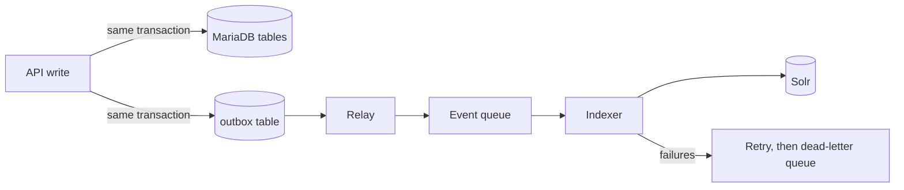

1. The API saves the change and an outbox row in one transaction. No lost events.
2. A relay reads new outbox rows and puts them on a queue.
3. The indexer reads the current row from MariaDB, builds the document and sends it to Solr in batches.
4. Retries with growing waits. After the limit the event goes to a dead-letter queue and raises an alert.
5. The same event twice is harmless: the document id is the same, so it just overwrites.
6. Out-of-order events are handled by version (see below).
7. Target: searchable within 5 seconds of commit (about 2.5 seconds typical, estimate). Measure it as a lag metric and alert at 3 seconds.

### Out-of-order events

Two events for the same item can arrive in the wrong order, for example after a retry. The rule is that the newest `row_version` always wins.

1. Every document carries the `row_version` from MariaDB, which goes up by 1 on each change.
2. Solr is set up to compare it on every update (its built-in version check on an external field). An update with a lower or equal version than the stored one is ignored.
3. The indexer also reads the current row from MariaDB rather than using the event content, so even an old event builds the newest document.
4. Deletes follow the same rule. A delete carries the row version, so a late old update cannot bring a deleted item back.
5. If anything still slips through, the nightly comparison of ids and versions repairs it.

Example: version 7 arrives, then a retried version 6. Solr keeps 7 and ignores 6.

## Sizing: collections, shards and replicas

If you know Cosmos DB, the ideas map across like this:

| Solr | Cosmos DB | Meaning |
|---|---|---|
| Collection | Container | One searchable set of documents, such as all stock items |
| Shard | Physical partition | A slice of the collection's documents. Each document lives in exactly one shard |
| Replica | Replica of a partition | A copy of one shard on another node, for availability and extra read capacity |

The difference: Cosmos picks partitions and replicas for you. In Solr you choose the numbers.

| Collection | Documents | Size | Shards x replicas | Why |
|---|---|---|---|---|
| `stock_item` | 6 million | about 12 GB (2 KB each, estimate) | 2 x 3 | 6 GB per shard, room to grow. 3 copies so one can be down for maintenance while another fails |
| `part` | 1.2 million | about 2.5 GB | 1 x 3 | Small, copies for availability |
| `location` | a few thousand | under 100 MB | 1 x 3 | Tiny, copies for availability |

Three nodes hold the 6 cores of `stock_item` (2 per node), plus the small collections. A search goes to one replica of each shard and merges the answers. The numbers are estimates until a load test.

## 3. Searchable index strategy

Goal: AB-1234/5, ab 1234 5 and ab12345 all find the same part.

| Field | How it is built | Finds |
|---|---|---|
| `part_number_key` | Remove everything except letters and digits, upper-case: `AB12345` | Exact match, ranked first |
| `part_number_search` | Same clean-up, lower-case, then split into prefixes of 2 to 20 characters at index time. No prefixes at query time | Partial typing: `ab12`, `ab123` |
| `part_number` split on punctuation | Tokens `AB`, `1234`, `5` | Typing only `1234`, ranked lower |

The search service cleans what the user typed with the same rule as the database. One shared rule, one shared test list.

Alternate parts: looked up when the user searches, not copied into stock documents.
1. Ask the `part` collection for the part and its alternates.
2. Search stock where `part_id` is in that list.
3. Mark results that came from an alternate.

Reason: one change to an alternate list would otherwise rewrite millions of stock documents.

## 4. Staleness policy

Stock documents copy `part_number` and `part_description` so search needs no join. When a part changes, those copies are briefly old.

| Question | Answer |
|---|---|
| When are copies updated? | After the part commit, by an event. Not in the same transaction, because a common part could lock thousands of stock rows. |
| How fast? | The part itself within 5 seconds. Copies on stock within 60 seconds (assumption to confirm), larger parts within 5 minutes. |
| What does the user see meanwhile? | Possibly the old description in the results list. |
| How is it caught? | Each search result carries `row_version`. When the user opens an item, the detail read comes from MariaDB. If its row_version is higher than the search result, the screen shows the fresh data and the API re-queues that document for indexing. |
| What about edits? | Updates send the row_version back (If-Match). If it is old, the API returns 412 and the client reads again and retries. |
| What if events are missed? | A nightly job compares ids and versions between MariaDB and Solr and repairs differences. |

Quantity, location, condition and status are never copied from another aggregate, so they follow the normal 5-second path.

## 5. Rebuilding the index with no downtime

Your understanding is right, with one word changed: it is a new Solr collection (the index), not a new container.

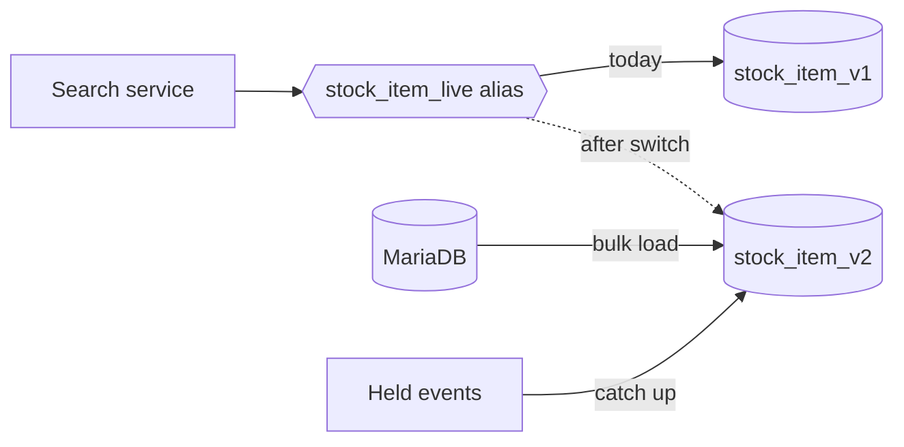

1. Create `stock_item_v2` with the new schema. Users keep searching `v1` through the alias.
2. Hold new change events while bulk-loading `v2` from MariaDB.
3. Apply the held events. The row_version check makes any overlap safe.
4. Check counts per base and compare sample searches with `v1`.
5. Switch the alias to `v2`. This is one instant step.
6. Keep `v1` for a few days. Rollback is switching the alias back. Then delete it.

Use this for analyzer or schema changes. Small partial updates are enough for the part-description fan-out.

## 6. Assumptions to validate

1. Sizes and load are estimates: 6 million stock documents, about 2 KB each, about 12 GB. Confirm with a load test.
2. 60 seconds is acceptable for copied part text.
3. Alternate chains are followed two levels.
4. Users at several bases can search across them. Rules for seeing another base's stock need a business answer.


# Field Naming Standard

One rule set for every layer, so a field reads the same in MariaDB, Solr, the API and the Angular code.

## 1. Case by layer, and the conversion rule

| Layer | Style | Example |
|---|---|---|
| MariaDB tables and columns | lower snake_case, singular table names | `stock_item.part_number` |
| Solr fields | identical to the database column | `part_number` |
| JSON (API) | lowerCamelCase | `partNumber` |
| TypeScript properties | lowerCamelCase, same as JSON | `partNumber` |
| TypeScript types | PascalCase | `StockItem` |

Conversion rule: split on `_`, lower-case the first word, capitalise the first letter of the rest, join. `stock_item_id` becomes `stockItemId`. The reverse is the opposite. It is mechanical, so a generator handles it and nobody types it by hand.
Abbreviations count as one word (`eccnCode`, `unNumber`, `ataRef`), so the rule never produces `eCCNCode`.

## 2. Tables, keys and references

- **Table:** singular noun for the business thing: `part`, `stock_item`, `location`, `movement_ledger_entry`. Child tables start with the parent: `part_alternative`.
- **Primary key:** `<table>_id`, BIGINT: `part_id`.
- **Public identifier:** `public_id`, a UUID. It is the only id exposed outside the system.
- **Foreign key inside Inventory:** the parent's key name, with a role prefix when needed: `part_id`, `previous_location_id`, `alternative_part_id`.
- **Reference to another module:** `<thing>_ref`, a text or number reference, with no foreign key: `approval_ref`, `ata_ref`, `model_ref`. The suffix tells a developer "this lives in another module". `base_id` is the one exception because every table uses it, and it is documented as the platform's base id.
- **Code from a lookup:** `<thing>_code` (`condition_code`). If the lookup table is also referenced, the id is `<thing>_id`.

## 3. Types and units in names

| Concept | Rule | Example |
|---|---|---|
| Boolean | Start with `is_`, `has_` or `allows_`. Always positive. | `is_serviceable`, `has_certificate`, `allows_allocation` |
| Date (no time) | End with `_on` | `shelf_life_expires_on`, `manufacture_date` becomes `manufactured_on` |
| Timestamp | End with `_at`, stored in UTC, DATETIME(6) | `received_at`, `movement_at` |
| Quantity | `quantity_<meaning>` with a unit code beside it | `quantity_on_hand` with `unit_code` |
| Money | `<meaning>_amount` or `unit_cost`, with a currency code beside it. State which currency in the name when two exist. | `unit_cost_base`, `unit_cost_order` with `order_currency_code` |
| Measurements | Unit suffix | `length_mm`, `weight_kg` |
| Free text | `description`, `remarks`. No other synonyms. | |
| Counts | `<thing>_count` | |

## 4. One term per concept

| Concept | Use | Do not use |
|---|---|---|
| Barcode | `barcode` | `BarCode`, `sStockBarCode` |
| Location | `location` | `bin`, `shelf`, `warehouse location` |
| Remarks | `remarks` | `comments`, `notes`, `StockRemarks` |
| Quantity | `quantity` | `qty` (as a full word) |
| Number | `number` | `no`, `num` |
| Previous | `previous` | `last` |
| Created and updated | `created_*`, `updated_*` | `modified`, `changed` |
| Receipt | `receipt` | `receive` as a noun |

Allowed abbreviations (industry or database terms): `id`, `ref`, `uuid`, `ata`, `eccn`, `oem`, `pma`, `nsn`, `un`, `mm`, `kg`, `url`. Anything else is written in full.

## 5. Standard system columns

These replace the nine columns repeated on every legacy table. They are mapped by rule, not row by row.

| Legacy column | New column | Rule |
|---|---|---|
| `ID` | `<table>_id` | Primary key. |
| `GUID` | `public_id` | The public identifier. The decision is to use `GUID` here because it is a stable unique value. |
| `Version` | `row_version` | The concurrency token, an integer that goes up by 1 on each update. |
| `RecordTimeStampCreated` | `created_at` | UTC. |
| `RecordTimeStamp` | `updated_at` | UTC. |
| `uRALUser_IDCreated` | `created_by_user_id` | Reference to the platform user. |
| `uRALUser_ID` | `updated_by_user_id` | Reference to the platform user. |
| `Closed`, `ReadOnly`, `RecordLocked` | Dropped. | Closing is a status on the business record. Locks are replaced by `row_version`. Read-only becomes permissions. |

## 6. Solr names

Same as the database column. Types are chosen by the schema, not by name suffixes, so the Solr field `part_number` is the same text as the column. Derived search fields add a suffix: `_search` for analysed fields, `_key` for normalised exact keys: `part_number_key`, `part_number_search`.

## 7. Renames applied to the DDL

| Current name | Problem | Proposed name |
|---|---|---|
| `do_not_allocate` (stock and location) | Negative boolean, no prefix | `is_allocation_blocked` |
| `shelf_life_required`, `certificate_required`, `manufacture_date_required` | Boolean without a prefix | `requires_shelf_life`, `requires_certificate`, `requires_manufacture_date` |
| `export_controlled` | Same | `is_export_controlled` |
| `trigger_shelf_life_from_first_use` | Same | `starts_shelf_life_on_first_use` |
| `query_missing_stock` | Same | `queries_missing_stock` |
| `life_not_known` | Same | `is_life_unknown` |
| `serviceable` (stock_condition) | Same | `is_serviceable` |
| `is_serviceable_location`, `is_unserviceable_location` | Long and a pair | `is_serviceable`, `is_unserviceable` |
| `is_query` (location) | Unclear | `is_under_query` |
| `is_default` (part_ata) | Fine, kept | none |
| `all_serial_numbers` | Boolean without a prefix | `applies_to_all_serials` |
| `manufacture_date` | Date should end in `_on` | `manufactured_on` |
| `unit_cost`, `order_unit_cost` | Currency not in name | `unit_cost_base`, `unit_cost_order` |
| `unit_name` (part) | Ambiguous | `unit_long_name` |
| `plant_code`, `warehouse_code` | Fine, kept | none |
| `category_code`, `condition_code`, `status_code` on stock | Fine, kept | none |
| `legacy_receipt_id` | Fine, a migration reference | none |
| `quantity` (ledger) | Matches the rule | none |

These renames have been applied to the DDL, the design notes and the Solr file.

## 8. The nine legacy examples from the assignment

| Legacy | Decision |
|---|---|
| `uRALUser_IDCreated` | `created_by_user_id`. The platform prefix goes, and the name now says it points at a user. |
| `sStock.sBaseWarehouseLocation_IDLast` | `stock_item.previous_location_id`. The type prefix goes, and "Last" becomes "previous". |
| `sPartAlternative.tApprovalID` | `part_alternative.approval_ref`. Other tables write `tApproval_ID`, and both spellings are the same reference to Technical Records, now named `*_ref`. |
| `BarCode` and `sStockBarCode` | One column: `barcode`. Which of the two is scanned in practice is an open question. |
| `sPartWriteOff.WriitenOffDate` | Typo fixed. Timestamp or date is unknown, so it goes to the ledger as `movement_at`, the business time. Check with the business whether time of day is held. |
| `sStockBaseTransfer.Date` | Becomes the transfer's `movement_at` on the ledger entry, so the word "date" no longer stands alone. |
| `AmountBaseTransferCost`, `AmountRCTransferCost` | Split by currency into `unit_cost_base` and a reporting-currency amount in the ledger `details`, with `order_currency_code` or `reporting_currency_code` beside it. "RC" is read as reporting currency, which needs confirming. |
| `sOrderPartReceipt.PartNo` and `Location` | Dropped. They are text copies of `part_id` and `location_id`. Search copies in Solr (`part_number`, `location_path`) are derived, not stored again. |
| `Version` and `GUID` | `Version` becomes `row_version`, the concurrency token. `GUID` becomes `public_id`. |


# API Design Notes

## Operations

| Operation | Method and path | Source |
|---|---|---|
| Search stock items | `GET /v1/stock-items` | Search index |
| Get one stock item | `GET /v1/stock-items/{stockItemId}` | Database |
| Receive stock, one or a batch | `POST /v1/stock-items` | Database |
| Change allowed fields | `PATCH /v1/stock-items/{stockItemId}` | Database |
| List movements | `GET /v1/stock-items/{stockItemId}/movements` | Database |
| Search parts, get one, create | `GET /v1/parts`, `GET /v1/parts/{partId}`, `POST /v1/parts` | Index, database, database |
| Search and create locations | `GET /v1/locations`, `POST /v1/locations` | Index, database |
| Check a background operation | `GET /v1/operations/{operationId}` | Database |

Identifiers in URLs are the public UUIDs, never the database numbers.

## Search

- **Free text** in `q`. Part numbers match however they are typed. The client sends what the user typed. No search-engine syntax is accepted or shown.
- **Filters** are named fields (`conditionCode`, `isServiceable`, `shelfLifeExpiresBefore`). Several values are comma separated. The server turns them into index queries.
- **Facets** are requested with `facets=conditionCode,statusCode` and returned as value and count pairs, computed with the other filters applied.
- **Sorting** is `sort=-receivedAt,partNumber`, limited to a listed set of fields. Anything else answers 400 with `SORT_FIELD_NOT_ALLOWED`.
- **Sparse fields** with `fields=partNumber,quantityOnHand`. Identifiers always come back.
- **Paging** is cursor-based only. The cursor is opaque and works at any depth, since the server uses a sort-key cursor. There is no offset, which fails past a few thousand rows.

## Create

- **Single item** returns `201` with the new object as the body, a `Location` header, and an `ETag`.
- **Batch of 2 to 500** returns `202` with an operation resource and a `Location` to poll. Each item succeeds or fails on its own, so one bad row never blocks the rest. The final state is `SUCCEEDED`, `PARTIALLY_SUCCEEDED` or `FAILED`, with one result per item in the order sent.
- **Idempotency.** The `Idempotency-Key` header is required. The server saves the key, a hash of the body and the result for 24 hours. The same key with the same body returns the saved result, marked `Idempotency-Replayed: true`. The same key with a different body is `422 IDEMPOTENCY_KEY_REUSED`. A repeat that arrives while the first is still running is `409 IDEMPOTENCY_REQUEST_IN_PROGRESS`. In a batch, the key covers the whole batch.
- **Validation** is listed in the operation text and matches the schema rules: serialised items have quantity 1, serial number unique per part, certificate required if the part says so, shelf life and manufacture date likewise, serviceable and location rules, and money with its currency. All broken rules are returned together as field errors.

## Concurrency

- Every read of one object returns an `ETag`, which holds the `rowVersion`.
- If two storekeepers open the same item, the first save wins. The second gets `412 VERSION_CONFLICT` with the current version number. The client reads the item again, shows what changed, and lets the user retry. The server never merges silently.
- The database update is `WHERE id = ? AND row_version = ?`, so this holds even when requests arrive together.
- Quantity, location, condition and ownership do not change through `PATCH`. They change through movements, so the ledger stays the single record.

## Consistency

Search follows the database by a couple of seconds, so the item you just created may not be in the results. The contract handles this three ways:

1. **Say how fresh it is.** Every search response has a `freshness` block with `indexedThrough` and `lagMilliseconds`. The screen can show "updated 2 seconds ago" and warn if the lag grows.
2. **Let the client wait.** Writes return `X-Consistency-Token`. The client sends it back in a `Consistency-Token` header on its next search. The server waits up to 2 seconds for the index to include that write, then answers. `includesConsistencyToken` says whether it did. This gives read-your-own-writes for the common "receive, then list" flow.
3. **Offer a current answer.** `GET` by id always reads the database. The Angular app, after a create, uses the object from the `201` and opens it by id.

## Errors

- Every error is `application/problem+json` following RFC 9457, with `type`, `title`, `status`, `detail`, `instance`, plus `code`, `requestId` and an `errors` list. Each field error has a JSON Pointer and a stable code.
- The code catalogue is the `ErrorCode` list in the contract. Codes are never renamed or reused. Clients treat unknown codes as a general error of that status, so new codes can be added without breaking anyone.
- Not found and not allowed at another base both answer `404`, so the existence of other bases' data is not revealed.

## Security

- OAuth 2.0 authorisation code with PKCE for the Angular app, and client credentials for other modules. OpenID Connect handles sign-in and discovery.
- Six scopes: stock, part and location, each with read and write.
- The token carries a `bases` claim. The server adds `base_id` to every database query and every search filter from that claim, and it intersects any `baseId` the client sends. A client can narrow but never widen. A base outside the claim answers `404` on an explicit request and silently disappears from searches.
- Scopes say what you may do. Bases say where. Both are checked on every request.

## Delivery

| Step | Approach |
|---|---|
| Contract first | The YAML file lives in the repository and changes through pull requests. Code follows the contract, not the other way round. |
| .NET server | Generate controller interfaces and models from the contract (NSwag or a similar generator). Developers implement the interfaces, so the server cannot drift from the contract without a compile error. |
| Angular client | Generate the TypeScript client and types from the same file (OpenAPI Generator), so field names match without hand-copying. |
| Linting | Redocly or Spectral in the build, with rules for naming (lowerCamelCase fields), required descriptions, and examples. A breaking-change check compares each pull request with the released contract and fails on removed fields, new required fields, or changed types. |
| Does the implementation match? | Contract tests run in the build. Schemathesis or a similar tool sends generated requests to a running test instance and checks every response against the contract. Hand-written scenario tests cover idempotency replay, `412` on stale writes, base filtering, and the consistency token. |
| Versioning | `/v1` in the path. Adding optional fields is not a breaking change. Removing or changing fields means `/v2`, with the old version kept for an agreed period. |


# Inventory Architecture

## 1. Context and containers

Who uses Inventory, what runs, and what it talks to.

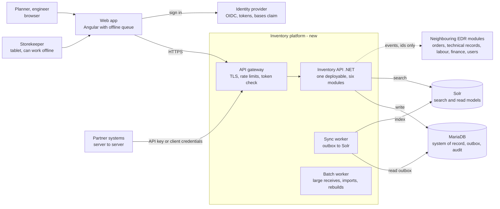

Same code base, three ways of running it: API, sync worker, batch worker.

## 2. Write path: receive a stock item

Synchronous, the caller waits (target p95 under 500 ms):

| Step | What happens |
|---|---|
| 1 Client | `POST /v1/stock-items` with an Idempotency-Key |
| 2 API | Check token and base. Look up the idempotency key. Validate the body |
| 3 Domain rules | Part exists, serial is unique, serialised quantity is 1, location accepts the condition |
| 4 One MariaDB transaction | stock_item, ledger entry, audit row, outbox row, saved response |
| 5 Response | 201 Created, ETag, Location, consistency token |

- If any step fails the whole transaction rolls back. Nothing half-saved, no outbox row, no Solr change.
- Same Idempotency-Key and same body: the saved response is returned and nothing is written twice.

Asynchronous, makes it searchable (target 5 seconds, typical 2.5 seconds):

| Step | What happens |
|---|---|
| 6 Sync worker | Polls the outbox every 0.5 s, takes rows in batches, one item in order |
| 7 Build document | Join part and location text into one flat document |
| 8 Solr | Add or replace with commitWithin 1 s. Same id means safe to repeat |
| 9 Searchable | Outbox row marked done. Lag metric updated |

Timeline: 0 ms request in, about 150 ms 201 returned, about 2.5 s searchable (typical), 5 s limit.

Solr down or slow: rows stay in the outbox and retry with backoff. Users keep saving. An alert fires when index lag stays over 10 s.

## 3. Read path: stock search

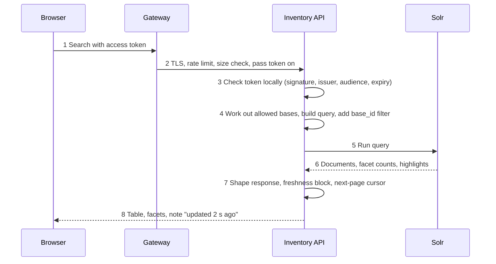

- Allowed bases come from the token `bases` claim (for example 3 and 5). If the caller asked for base 5 only, use that, never more than the claim.
- User text never becomes raw Solr syntax. Named filters are turned into a Solr query.
- Optional: wait for the caller's consistency token, up to 2 s.
- Second lock inside Solr: the search handler has the base filter and row limit as fixed rules. Request parameters cannot override them. Only the API service account can reach Solr.
- Scale: replicas answer, so 2,500 users spread over 6 copies of the data. The base filter is cached.
- Rule: the filter is added by the server in two places. The client has no parameter that can remove or widen it. A request for another base returns 404, not 403, so base existence is not leaked.
- Lookups by id (`GET /v1/stock-items/{id}`) skip Solr and read MariaDB with the same base check. Target p95 under 300 ms at 2,500 users.

## 4. Deployment

| Environment | Description |
|---|---|
| Dev | One node each, containers |
| Test | Shared, small, test data |
| Staging | Production shape, for load tests and restore drills |
| Production | Three zones, below |

A load balancer and gateway sit in front: health checks, TLS, spread over all three zones.

| | Zone A | Zone B | Zone C |
|---|---|---|---|
| .NET services | Inventory API and workers, 2 instances, stateless | same | same |
| Solr cluster | 1 Solr node (2 replicas each) and 1 ZooKeeper | same | same |
| MariaDB | Primary (writes go here) | Replica, semi-synchronous (takes over if A fails) | Replica, asynchronous (reporting and restore tests) |

Backups: full copy nightly, change log shipped every minute. Both encrypted and copied to a second region.

| Scenario | How it is met |
|---|---|
| Zone failure | Database fails over to the replica in Zone B. Solr and ZooKeeper keep a majority. No acknowledged write is lost |
| Data damage, RPO 5 min | Restore to a point in time from the log. At most 1 minute of log is outside the copy, within the 5 minute limit |
| Whole region, RTO 1 hour | Restore the database from the second-region copy, point the app there, rebuild Solr from the database. Planned under 1 hour. Proven in a drill |

## 5. Service shape: a modular monolith

One deployable, six modules, reads and writes kept apart. Modules: Part Catalogue, Stock and Receipt, Warehouse and Location, Demand and Issue, Despatch and Transfer, Stock Control.

The same four layers are in every module. Modules talk only through a small interface or an event.

| Layer | Write side | Read side |
|---|---|---|
| 1 API | ASP.NET Core controllers, generated from the OpenAPI file. Token, base, idempotency | same |
| 2 Application | Commands: handlers that change data, one transaction each | Queries: search and lookups, no business rules, no writes |
| 3 Model | Domain: aggregates and rules, no database or web code | Read models: flat shapes built for the screen |
| 4 Data | MariaDB access: EF Core for aggregates, Dapper for batch, outbox writer | Solr and read access: Solr client over HTTP, by-id reads go to MariaDB |

- Why one deployable: one team of a few developers and two months. One transaction for stock, ledger and outbox, one build, simple tracing. Modules are split cleanly so a hot one can move out later.
- Rejected, a service per context: network calls, distributed transactions between stock and ledger, many pipelines. The load (about 40 million movements a year) does not need it.
- Rules kept by the build: architecture tests fail the build if a module reads another module's tables or if the domain layer references the database. Workers run the same code, started in a different mode.

## 6. Decisions

| Decision | What we chose | Rejected, and why |
|---|---|---|
| Data access | EF Core for aggregates, Dapper for batch and hot queries. Solr over plain HTTP. Stock item, ledger, audit, outbox and saved idempotency response commit in one MariaDB transaction. The sync worker moves outbox rows to Solr | Writing to MariaDB and Solr in the same request: one can fail and the two drift apart. A change-capture tool: one more system to run. Revisit if polling the outbox cannot keep up |
| Caching | Signing keys in memory 24 h. Lookups in memory 10 min, refreshed when a version stamp changes. Solr filter cache for the base filter. Browser keeps lookups and uses ETag on by-id reads. Search results are not cached | A shared cache for search results: every key needs the base, results go stale against the 5 s target, one more thing to run |
| Identity and access | OIDC bearer tokens checked locally with cached keys. `bases` claim lists allowed bases. Server adds the base filter in the API and inside Solr. All MariaDB queries go through one base-scoped helper. Roles map to six scopes | Asking the identity provider on every request: slower and tied to its outages. Trusting a base id from the client: it can be changed |
| Observability | OpenTelemetry for logs, metrics and traces. A trace id travels from browser to Solr and comes back in every error | Log files and CPU alerts only: they do not show what the user feels, such as slow search or a late index |
| Service shape | One deployable, six modules. Commands write to MariaDB, queries read Solr or MariaDB by id. Workers run the same code in another mode | A service per context |
| Clustering and recovery | MariaDB: primary, semi-sync replica, async replica in three zones. Solr: 3 nodes, 2 shards, 3 copies each, with 3 ZooKeeper. Solr is rebuilt from MariaDB, not backed up. Nightly full copy and change log every minute, copied to a second region. Restore drill every quarter | Multi-primary MariaDB: conflicts on hot rows, slower writes. Backing up Solr as if it were the truth |
| Compliance | Ledger and audit tables are append-only: the app account has no update or delete right, and triggers refuse it. Nightly copy of audit rows to write-once storage. TLS everywhere, encryption at rest, keys in a vault. Assumption: keep records 7 years after the item leaves stock | Edit in place with history triggers, or soft-delete flags: history can be altered and is hard to prove to an auditor |
| Hangar offline | Tablet app (PWA) keeps the last search, lookups and the store location list. Receives, issues and moves are saved as commands with their own idempotency key and sent on reconnect | Full offline copy of stock on every device: large, quickly stale, a leak if a tablet is lost. Offline edits of descriptive fields: version conflicts |

## 7. Degraded modes

| If this fails | Users can still | Users see | The system does |
|---|---|---|---|
| Solr is down | Receive, issue, move, edit. Find an item by part number, serial or location code through a small database search, up to 50 rows | A yellow banner: search is limited. No facets, no free text | Keeps changes in the outbox, catches up when Solr returns. Pages on-call after 5 minutes |
| Sync lags by minutes | Everything. New items may be missing from search. Opening an item by id always shows database truth | A note on results: updated 3 minutes ago. Own changes show up by id | Consistency wait stops at 2 s. Warning at 10 s of lag, page at 60 s. Extra sync workers start |
| Identity provider slow or down | Keep working with a valid token (checked locally with cached keys) | New sign-ins fail with a clear message. Tablets keep their queue | Keys cached 24 h. Access token lasts 1 h (assumed), refreshed quietly. Sign-in retries with backoff |
| Database primary fails | Search and read from Solr. Open items from search results | Saving paused for about 1 to 2 minutes, with a retry message | Fails over to the replica in Zone B. Retries are safe because of idempotency keys. Tablets queue and resend |

## 8. Hangar reality: working offline

- Works offline: look at the last searches and items opened today. Part details and the store location list for this base. Scan a barcode. Record a receive, an issue, a move or a stock count line. All are saved on the tablet and queued.
- Needs a connection: first sign-in. Free search across all stock. Editing descriptive fields. Creating a new part. Anything that needs the latest balance to be certain.

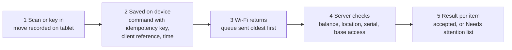

| Situation | How it is settled |
|---|---|
| Two people use the same stock | Moves are added in the order they reach the server, so nobody overwrites anybody. Each is accepted if the balance is still valid. Their own time is kept in the ledger |
| Item already gone | A serialised item issued twice, or not enough quantity: the late one is rejected. It appears in Needs attention with the reason, and a person decides |
| Sent twice | Ignored. The idempotency key returns the first result |
| Offline too long | Keys are kept 24 hours. Older queued items need a supervisor to confirm before they are sent |

Assumption: tablets keep their queue on the device, encrypted, and wipe it after the server confirms. A lost tablet can be blocked from the server.

## 9. Service levels and proving recovery

| Measure | Target | Alert |
|---|---|---|
| Search latency | p95 under 300 ms | Warn at 250 ms for 10 min. Page at 300 ms for 10 min |
| Create latency | p95 under 500 ms | Warn at 400 ms. Page at 500 ms for 10 min |
| Index lag | p95 under 5 s | Warn: oldest outbox row over 10 s for 5 min. Page: over 60 s |
| Availability | 99.9% a month (about 43 min) | Page when 2% of the month budget burns in one hour |
| Database replica lag | Under 30 s | Warn at 30 s. Page at 3 min, as the RPO is 5 min |

Three signals: logs (structured, trace id, no personal data), metrics (rate, errors, duration per endpoint, outbox depth, Solr query time, replica lag), traces (browser to API to MariaDB and Solr, one trace id).

Proving the 5 minute RPO and 1 hour RTO, every quarter in staging at production size:
- Failover drill: stop the primary under load. Record failover time and writes lost. Target: none lost.
- Restore drill: restore the last full copy plus the change log to a point in time. Time it to the first successful search.
- Rebuild Solr: rebuild all 6 million documents from MariaDB into a new collection and swap. Estimate 20 to 30 minutes, to be measured.
- Every day: alert if the newest shipped log is older than 3 minutes.

## 10. Five biggest risks

| # | Risk | How we reduce it | Early warning |
|---|---|---|---|
| 1 | Legacy meaning is guessed. Nobody on the team knows the domain. A wrong unit, flag or status breaks trust and may affect safety records | Assumptions listed on page 1 and checked in two workshops with a storekeeper and a records clerk. Nine business reconciliations on migrated data. Run side by side before switching | Reconciliation checks that fail in rehearsal |
| 2 | Cut-over and data quality. 6 million stock rows with years of dirty data. Old and new can drift while both run | Rehearse the cut-over three times. Move one base at a time. Counts, checksums and samples at each step. Old system stays read-only as the way back | Rehearsal takes longer than the window |
| 3 | Search is trusted too much. A late index shows an item as available when it is not | Issue and move are always checked against MariaDB, not Solr. Freshness note on results. Lag alerts. Weekly count comparison of rows and documents | Index lag alerts, count mismatch |
| 4 | Another base sees data. The base filter is lost in one query | Filter added on the server in the API and inside Solr. Automated tests with users from two bases on every build. Penetration test before go-live | A failing two-base test |


# AI-Assisted Delivery Plan

## 1. Lifecycle map

Where AI helps, what a person still decides, and what proof we keep. Stage 10 is added: handover and training.

| Stage | AI-assisted activity | Human control that stays | Evidence collected |
|---|---|---|---|
| 1 Legacy comprehension | Reads the 839 business columns and the 53 log tables, drafts a plain meaning, unit and guess for each, and lists doubts | A domain expert confirms or corrects every assumption before it is used | Assumptions log with who confirmed what, and when |
| 2 Schema and mapping | Drafts DDL and mapping rows from the naming standard (sBaseWarehouseLocation_IDLast to previous_location_id) | Architect reviews. DDL is run on a test MariaDB server before merge | Mapping sheet diff, migration run log |
| 3 Migration and reconciliation | Writes extract scripts and the count, checksum and business-check queries | Dry run on masked data. A person signs off each reconciliation result | Rehearsal reports, mismatch counts |
| 4 API contract | Drafts paths, examples and error cases from the aggregates | Architect owns the OpenAPI file. Lint and breaking-change check in the build | Lint report, review notes |
| 5 Backend code (.NET) | Drafts handlers, EF mappings and unit tests from the contract and aggregate rules | Tests come first. Two-person review. Architecture tests block layer breaks | Pull request cycle time, defects found in review |
| 6 Front end (Angular) | Drafts components and stories from the catalogue and tokens. Generated client from the contract | Accessibility review and screenshot approval by a person | Storybook coverage, accessibility reports |
| 7 Test design | Turns each aggregate rule into test cases (serialised item quantity is 1, stock never below zero, unserviceable not in a serviceable location) | People own the rule list. Mutation testing shows whether tests really check | Rules covered, mutation score |
| 8 Review and security | Summarises pull requests, flags risky changes, runs scanners | A named human approves every merge. Scanner findings block | Findings and fix times |
| 9 Release and operations | Drafts runbooks, alert text and incident timelines from logs | On-call engineer owns the runbook. Restore and failover drills are run by people | Drill results, incident reviews |
| 10 Handover and training (added) | Drafts user guides, release notes and onboarding notes from the code and stories | Storekeeper and records clerk review for accuracy | Review sign-off, support questions |

## 2. AGENTS.md: the standing instructions

One file at the repository root. Every coding tool reads it first, so behaviour is the same whichever tool a developer uses. Keep it short and review it like code.

```markdown
# AGENTS.md

## Project
Inventory modernisation. .NET 10 API, Angular UI, MariaDB, Solr.
Naming: camelCase in API and UI, snake_case in MariaDB and Solr. See docs/naming-standard.md.

## Do
- Read docs/ (naming standard, OpenAPI file, aggregate rules) before writing code.
- Write the test first, then the code.
- Keep each change small: one aggregate or one endpoint per pull request.
- Use the base-scoped query helper for every MariaDB query.
- Return errors from the shared error catalogue.
- Say "I am not sure" and list the assumption instead of guessing a meaning.

## Do not
- Do not merge, push to main or change the build pipeline.
- Do not edit the OpenAPI file without being asked. It is owned by the architect.
- Do not read from or write to another module's tables.
- Do not use real stock, serial or certificate data. Use the masked samples in /samples.
- Do not decide serviceability, release or life limits. Draft and flag only.
- Do not add a new dependency without asking.

## Commands
Build: dotnet build   Test: dotnet test   Lint API file: spectral lint api/inventory-api.yaml
```

Nested AGENTS.md files can add rules for one folder, for example `/ui` with the component and accessibility rules.

## 3. Skills: repeatable steps for each kind of task

A skill is a folder with a short SKILL.md that tells the agent the steps for one task, plus examples. The agent loads the skill only when the task matches, so context stays small.

| Skill | Steps the agent follows |
|---|---|
| map-legacy-column | 1. Look up the column in the glossary. 2. Apply the naming standard. 3. Propose the new name, type and rule. 4. List the assumption and mark it "to validate". 5. Add a row to the mapping sheet |
| write-api-endpoint | 1. Start from the OpenAPI path. 2. Write the failing contract test. 3. Write the command or query handler. 4. Add base filter, idempotency and row_version checks. 5. Run lint and tests. 6. Open a pull request |
| write-domain-rule | 1. Take the rule from the rule list. 2. Write unit tests, including the edge cases. 3. Implement in the aggregate. 4. Run mutation tests. 5. Link the rule id in the pull request |
| write-tests | 1. Turn each rule into cases (normal, boundary, forbidden). 2. Name tests by the rule. 3. Run them and show they fail before the code exists |
| build-ui-component | 1. Start from the component catalogue and tokens. 2. Write the story. 3. Use the generated API client. 4. Check keyboard use and contrast. 5. Attach screenshots for approval |
| review-pull-request | 1. Summarise the change. 2. Check against AGENTS.md rules. 3. Flag base-filter, naming and migration risks. 4. Suggest, never approve |

Each skill has one worked example and a small check that runs in the build, so a broken skill is noticed.

## 4. Good practices to choose from

| Practice | Why it helps | Cost |
|---|---|---|
| Spec first: the OpenAPI file and rule list are written before code | Agents generate from a contract, so output is checkable | Architect time up front |
| Tests first, written from the rule list | Invented code fails the test, tests do not come from the code | A little slower per ticket |
| Plan, then implement: the agent posts a short plan and a person approves it | Wrong direction is caught before code exists | One review step |
| Small pull requests, one agent task each | Easy to review and revert | More pull requests |
| Separate agents for write and review | A second pass catches what the first missed. A person still approves | Extra tool cost |
| Prompts and skills versioned and tested | Quality does not drift between developers | Needs an owner |
| Build checks (naming lint, architecture tests, API lint) | Rejects output that ignores the rules, whichever tool wrote it | Set up once |
| Short pilot with a baseline | Proves the gain with numbers instead of opinion | Two weeks |

Pilot rule (proposal): two weeks, half the endpoints with AI help and half without, then swap. Continue if lead time is at least 25% shorter and defects and rework are no worse. Stop if they rise by more than 20% or production data reaches an outside tool.

## 5. Guardrails

| Guardrail | What it means |
|---|---|
| Human review | Nothing merges without a named human approver, who is accountable. Agents open pull requests and never merge. Changes to rules, money or certificates need two reviewers |
| Data handling | No production data in outside tools. Tools see the schema, the mapping and masked or made-up samples only. Serial numbers, certificate numbers and names are masked |
| Licence and provenance | Licence scan on new dependencies and on code that looks copied. Only approved tools and models are used. Each pull request notes if AI helped |
| Security scanning | Static analysis, dependency, secret and container scans run on every pull request. A finding blocks the merge |
| Tests are the truth | Invented code fails against tests. Tests come from the rule list, not from the code. Mutation tests show if tests are real. A generated test cannot be accepted just because it passes |
| Cost control | A monthly budget per team and a usage report. Prefer small models for routine drafting. Stop runaway agent runs by time and spend limits |
| Traceability in aviation | The pull request records the tool, the task and the human reviewer. Prompts and the context pack are versioned. Anything touching traceability, life data or certificates has a named responsible person and a release record |
| Not for airworthiness decisions | AI never decides serviceability, release or life limits. It can draft and flag. Certified people decide and sign |

## 6. In the product (optional)

- Natural-language stock search: the user types a sentence, the API turns it into the existing filters, shown as chips the user can edit. No stock data is sent.
- Count-anomaly flags: a nightly job ranks odd stock counts with a reason. It writes nothing to stock, and a person recounts or dismisses.

Both are suggestions only. Neither decides airworthiness.

# How I used AI

I used one tool for this assignment: Perplexity Computer. I gave it the two source documents, the assignment brief and the legacy schema workbook (Attachment A). Then I worked through the tasks one at a time, in a series of prompts.

## What I used it for

- Explaining the domain. I have no aviation or inventory background, so I asked it to explain tables, rules and terms in plain language.
- Drafting the first versions of the bounded contexts, aggregates, disposition table, migration approach, MariaDB DDL, Solr and sync design, naming standard and sample mapping, OpenAPI file, architecture, UI library and AI delivery plan.
- Producing the diagrams and the Mermaid versions of the ERD and architecture.

## How I checked it

- After each draft I compared it against the requirement in the brief and tested whether it made sense, asking follow-up questions where I didn't understand it. Examples are BIGINT versus GUID, how row_version and If-Match work, why the idempotency key in header was suggested etc.
- I ran the generated files myself. I hit and reported errors, such as the `sensitive` column in the DDL and the OpenAPI example on line 319, and had them fixed.
- I reviewed the final document against the brief and found leftover text, contradictions and missing parts, then had those corrected.

## What I changed or decided myself

- I chose the direction on the key choices: six contexts, camelCase for the API and UI with snake_case for MariaDB and Solr, and a generic migration approach.
- Architecture:
  - I advised a modular monolith for the Inventory module, because the team is small and the timeline is two months.
  - I suggested an async worker to build the read model in Solr, so writes never wait on search.
  - I had the API gateway validate tokens and enforce rate limits and quotas, with the API checking again for base access.
  - I asked for `row_version` checks on both reads and writes. Reads carry the version in the ETag, and updates are rejected with a 412 when it is stale.
- I asked for simpler versions where I thought the draft was too complicated, including the Solr write-up, the AI plan, and the offline design.
- I listed the places where meaning is an assumption, because the domain knowledge isn't mine.
